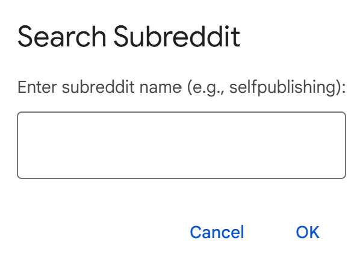

# Reddit Blog Matcher & AI Comment Generator (2025)

**Original Google Apps Script project · JavaScript · Google Sheets · Reddit data · Gemini API**

A historical source-code archive of a tool I built in 2025 to help a colleague transitioning into social media marketing identify useful Reddit conversations, connect them with relevant existing blog content, and draft responses for human review.

The original interface ran inside a Google Sheet. A custom **Reddit Blog Matcher → Search Subreddit** menu opened a dialog where my colleague could enter a subreddit. The script retrieved recent posts, checked their titles and text against keywords in an editorial content inventory, and wrote matches to a results sheet. I later added a Gemini-powered function to produce draft comments. A human reviewer could edit and decide whether to publish a reply where community rules permitted it.

> **Historical archive, not a live service.** `Code.gs` preserves the source recovered from my original Apps Script project, including successive versions of functions. It has *not* been modernized or verified against today's Reddit or Gemini APIs. The data and AI integrations may require authorized API access and updated endpoints. No automated posting functionality is included.

## Problem and audience

A colleague had been promoted into a social media role because of her excellent customer communication. The job also required monitoring relevant communities, spotting questions that existing articles could answer, and developing appropriate responses. I provided marketing-strategy mentorship and wrote this tool to reduce repetitive discovery and matching work, while leaving the actual engagement and judgment with her.

## What the original code demonstrates

- **Google Apps Script development:** custom menu and prompt built with `SpreadsheetApp.getUi()`.
- **HTTP requests and JSON parsing:** fetched Reddit discussion data using `UrlFetchApp.fetch()`.
- **Keyword-based relevance matching:** compared Reddit title/body against content-library keywords.
- **Spreadsheet automation:** used `BlogContent` as an input and wrote matched opportunities to `RedditMatches`.
- **Generative AI integration:** used a Gemini API request to draft contextual comments.
- **Credential hygiene:** loaded the API key from Apps Script `PropertiesService`, rather than including it in the source.
- **Human-in-the-loop design:** generated suggestions for a colleague to revise manually, not automatic publishing.

## Data model

| Sheet | Columns in the historical design | Purpose |
| --- | --- | --- |
| `BlogContent` | `Blog Title`, `Category`, `Keywords`; code also expects the full article body in column D | Library of potentially relevant editorial content |
| `RedditMatches` | `Reddit Post`, `Subreddit`, `Upvotes`, `Matching Blog`, `Category`, `Post URL`, `Generated Comment` | Opportunities and editable draft responses |

The restored spreadsheet snapshot contains **231 content inventory entries, 21 matched response records, and four distinct Reddit discussions**. Those counts describe stored rows, **not** a measured traffic increase, published comments, or automatic reach. No source spreadsheet or employer content is included in this repository.

## How the workflow operated

1. An editor opened the bound Google Sheet.
2. The custom *Reddit Blog Matcher* menu appeared on open.
3. They selected **Search Subreddit** and entered a subreddit.
4. The script fetched recent posts and compared them against the article inventory.
5. Results and possible Gemini-drafted responses were displayed in `RedditMatches`.
6. The editor reviewed and rewrote drafts and decided whether or how to participate.

See [architecture notes](docs/architecture.md) for the data path and [technical notes](docs/technical-notes.md) for limitations.

## Historical source code

- [`Code.gs`](Code.gs) — recovered original Apps Script source, **preserved as supplied**.
- [`screenshots/search-subreddit-dialog.png`](screenshots/search-subreddit-dialog.png) — historical UI screenshot.

For a **new** Apps Script project, create a Sheet and open **Extensions → Apps Script**. Copy the source only for inspection or modernization, not expecting it to run unchanged. The old Reddit `.json` endpoints and Gemini 1.5 Flash reference need reevaluation under current provider rules; use authorized API access. The column-D content assumption and duplicated function declarations also require attention. Never put an API key in GitHub.

## Historical vs. modern portfolio demo

This repository holds the **original 2025 source**. My separate **ThreadScout** demo is a new, self-contained JavaScript application that uses **fictional discussions and editable template responses**. It does not claim to run this original Reddit/Gemini integration.

## Limits and verification

The original recovered code was reviewed for its structure and obvious issues; the current repository does **not** claim contemporary successful live API calls or unit-test coverage for the 2025 version. See [technical notes](docs/technical-notes.md). The existence of historic result rows supports that the workflow produced outputs, but it does not establish which particular API calls were successful on which dates.

## Responsible engagement

The application was intended for staff to participate only where community rules allowed relevant, transparent engagement. Drafts were subject to human review. Generated suggestions could contain assumptions, placeholders, or unverified facts and required verification before use.

## Authorship and rights

I wrote and own this source code. The original workflow was created for a colleague during my time at Publishing.com. This repository deliberately excludes former-employer blog text, private records, credentials, and production data. This project archive is offered for portfolio review; no open-source license has been granted by default.
